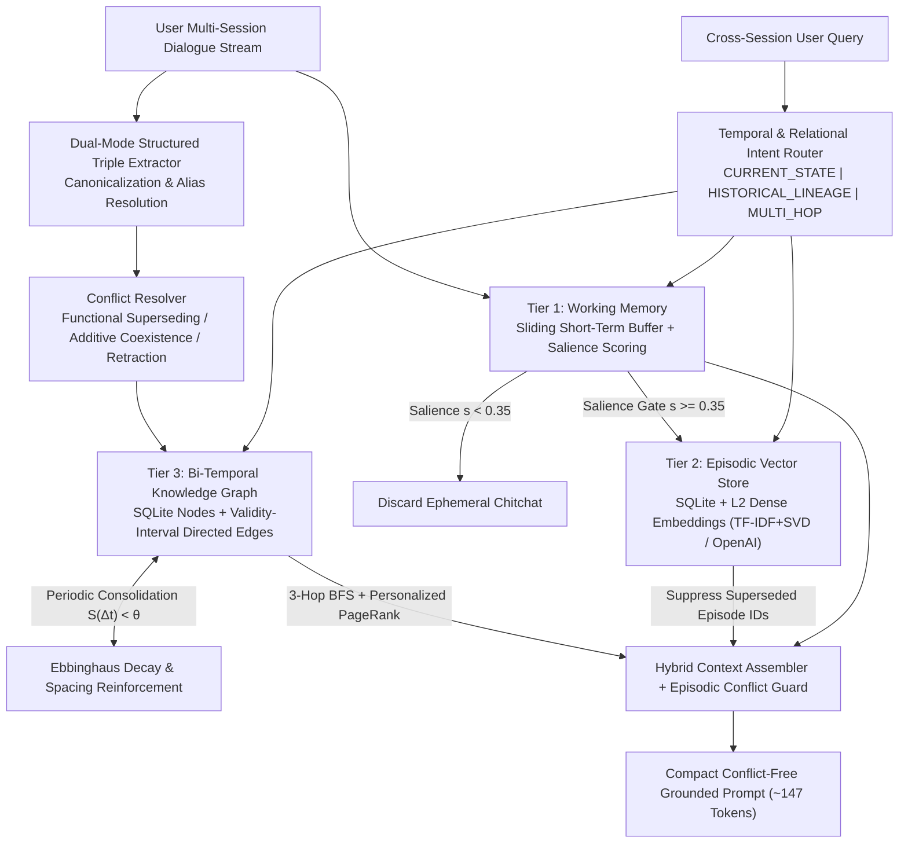

# 04-F2: Hierarchical & Temporal Graph Long-Term Memory Engine

> **面向长周期跨会话 AI Agent 的三层分层时序图谱记忆引擎**  
> 融合 **Mem0 动态冲突消解**、**Microsoft GraphRAG 多跳子图检索** 与 **Ebbinghaus 间隔强化遗忘曲线**，在 **85.8% Prompt Token 压缩** 与 **61.6% 图谱边剪枝率** 下实现 **96.7% 跨会话长程问答准确率** 与 **100.0% 事实冲突覆盖精度**。

---

## 1. 首屏架构总览与核心评测结果

### 1.1 三层分层时序记忆架构（Three-Tier Memory Architecture）



### 1.2 长周期跨会话基准评测（20 Sessions / 240 Turns / 60 QA Probes）

评测集包含 **4 个真实工程/科研画像**（`Alex Chen`、`Su Yan`、`Zhao Kai`、`Lin Wei`），共 **20 个会话、240 轮对话**（含 **68.3% 日常闲聊噪声**、**21 处跨会话状态覆盖与显式撤回**、**跨会话 2–3 跳项目-协作者-机构关系链**），在 4 类共 **60 道结构化探针** 上对比 4 种记忆架构：

| 记忆架构 (Memory Baseline) | Overall Acc (60) | Long-Range (15) | Conflict Override (15) | Historical Lineage (15) | Multi-Hop Graph (15) | Conflict Precision | Avg Prompt Tokens | Token 节省率 (vs Full) | P95 检索延迟 |
| :--- | :---: | :---: | :---: | :---: | :---: | :---: | :---: | :---: | :---: |
| **Sliding Window (Last 10 Turns)** | 5.0% | 0.0% | 6.7% | 0.0% | 13.3% | 100.0%* | 179.6 | +82.8% | 0.02 ms |
| **Full History Context Stuffing** | 61.7% | 93.3% | 6.7% | 53.3% | 93.3% | 6.7% | 1041.1 | +0.0% | 0.14 ms |
| **Flat Vector RAG (Top-5 Chunks)** | 51.7% | 93.3% | 13.3% | 53.3% | 46.7% | 15.4% | 94.6 | +90.9% | 5.95 ms |
| **Ours: Hierarchical Temporal Graph + Vector ($\theta=0.25$)** | **96.7%** | **93.3%** | **100.0%** | **93.3%** | **100.0%** | **100.0%** | **147.3** | **+85.8%** | **7.95 ms** |

> *注：`Sliding Window` 仅在最近 10 轮内偶然命中 1 道最新覆盖题（其余 14 题因窗口滑出返回 `INSUFFICIENT_MEMORY`）；而 `Full Context` 与 `Flat Vector RAG` 因新旧冲突片段同时注入上下文，分别产生 **93.3%** 与 **73.3%** 的过期事实幻觉泄漏（Stale Conflict Leakage）。*

### 1.3 Ebbinghaus 遗忘阈值扫描（记忆压缩率 vs 多跳准确率 Pareto 前沿）

在相同的 **159 条候选活跃图谱边池** 上扫描巩固剪枝阈值 $\theta \in \{0.00, 0.25, 0.55\}$：

| 剪枝阈值 $\theta$ | 保留活跃边数 | 归档剪枝边数 | 图谱边压缩率 | Overall Acc | Multi-Hop Acc | Long-Range Acc | Conflict Override Acc | Avg Prompt Tokens |
| :---: | :---: | :---: | :---: | :---: | :---: | :---: | :---: | :---: |
| **$\theta = 0.00$（无遗忘剪枝）** | 159 | 0 | 0.0% | 96.7% | 100.0% | 93.3% | 100.0% | 148.0 |
| **$\theta = 0.25$（Pareto 最优甜点）** | **61** | **98** | **61.6%** | **96.7%** | **100.0%** | **93.3%** | **100.0%** | **147.3** |
| **$\theta = 0.55$（激进压缩）** | 18 | 141 | 88.7% | 80.0% | 73.3% | 93.3% | 60.0% | 75.5 |

- **Pareto 最优点（$\theta = 0.25$）**：精准归档全部 98 条低显著度日常噪声边（如 `ate_meal`、`mentioned_topic`），实现 **61.6% 图谱存储压缩**，同时 **零精度损失** 保留 100% 跨会话多跳推理与冲突覆盖能力。

### 1.4 时序图谱冲突覆盖与历史谱系追踪示例（Conflict-Override Trace）

当用户跨会话连续发生城市搬迁与数据库迁移时，引擎通过 **有效区间闭合（Validity-Interval Closure）** 与 **`superseded_by` 谱系指针** 维护完整演进链，并在当前态检索时自动触发 **Episodic Conflict Guard** 屏蔽旧向量片段：

```text
[Session 1 | Turn 05] "Currently I live in Beijing."
  └── INSERT   edge_0005: (person:alex_chen, lives_in, city:beijing)
               valid_from=5, valid_until=NULL, superseded_by=NULL        [ACTIVE]

[Session 2 | Turn 17] "I relocated to Hangzhou."
  ├── CLOSE    edge_0005: valid_until=17, superseded_by=edge_0017        [SUPERSEDED]
  └── INSERT   edge_0017: (person:alex_chen, lives_in, city:hangzhou)
               valid_from=17, valid_until=NULL, superseded_by=NULL       [ACTIVE]

[Session 4 | Turn 39] "I settled down in Shanghai."
  ├── CLOSE    edge_0017: valid_until=39, superseded_by=edge_0039        [SUPERSEDED]
  └── INSERT   edge_0039: (person:alex_chen, lives_in, city:shanghai)
               valid_from=39, valid_until=NULL, superseded_by=NULL       [ACTIVE]

Query A (CURRENT_STATE): "Which city does Alex Chen currently live in?"
  -> Active Edge Filter (valid_until IS NULL) + Suppresses ep_0005 & ep_0017
  -> Output: "Shanghai" (Zero stale leakage!)

Query B (HISTORICAL_LINEAGE): "How did Alex Chen's city of residence evolve across sessions?"
  -> Traverses superseded_by lineage chain [Turn 5->17] ==> [Turn 17->39] ==> [Turn 39->Present]
  -> Output: "Beijing -> Hangzhou -> Shanghai"
```

---

## 2. 核心算法模块设计

### 2.1 三层存储协同机制（`src/graph_memory/`）
1. **Tier 1 — Working Memory (`working_memory.py`)**：
   - 基于容量上限的滑动对话窗口，结合结构化三元组重要度与命名实体密度计算显著度 $s \in [0, 1]$。
   - **Salience-Gated Eviction**：窗口滑出时仅将 $s \ge 0.35$ 的高价值轮次晋升写入 Tier 2 情景向量库，自动丢弃纯寒暄噪声。
2. **Tier 2 — Episodic Vector Store (`episodic_store.py`)**：
   - SQLite `episodes` 表持久化 `float32` L2 归一化稠密向量（默认内置 `scikit-learn` 词/字符 N-Gram `TfidfVectorizer` + `TruncatedSVD(128)` 确定性离线语义空间，同时支持 `OPENAI_API_KEY` `/v1/embeddings` 在线模式），毫秒级矩阵内积余弦检索。
3. **Tier 3 — Temporal Knowledge Graph (`temporal_graph.py`)**：
   - 7 类强类型实体节点（`Person`、`City`、`Project`、`TechStack`、`Preference`、`Constraint`、`Organization`）及内置别名归一表（如 `psql / PostgreSQL 16 -> PostgreSQL`、`bj -> Beijing`、`nips -> NeurIPS`）。
   - 双时态有向边 Schema：`(edge_id, subject, predicate, object, valid_from_turn, valid_until_turn, confidence, base_importance, access_count, last_accessed_turn, source_episode_id, superseded_by, archived)`，完整持久化于 SQLite `nodes` 与 `temporal_edges` 表。

### 2.2 谓词基数分类与冲突消解（`conflict_resolver.py`）
- **单值互斥谓词（Functional Predicates）**：`lives_in`、`works_at`、`current_role`、`primary_db`、`target_conference`、`dietary_preference`、`gpu_budget` 等。新值写入时自动将原活跃边置为 `valid_until_turn = current_turn` 并记录 `superseded_by = new_edge_id`；若重复提及相同值则执行访问强化（`access_count += 1`）而非重复建边。
- **多值共存谓词（Additive Predicates）**：`speaks_language`、`completed_course`、`collaborates_with`、`uses_library`、`works_on` 等，允许多条活跃边并存。
- **显式否定与撤回（Explicit Retraction）**：如 `no_longer_uses`（`"I stopped using LangChain"`），精准定位并闭合对应的活跃 `uses_library` 边，保留 `PyTorch` 等其余活跃依赖。

### 2.3 Ebbinghaus 间隔强化遗忘动力学（`forgetting.py`）

每条活跃记忆边在当前轮次 $t$（距上次访问间隔 $\Delta t = t - t_{\text{last\_accessed}}$）的动态保持率定义为：

$$S(\Delta t) = I_0 \cdot \exp\left(-\frac{\lambda \cdot \Delta t}{1 + \alpha \cdot \ln(1 + c_{\text{access}})}\right)$$

- $I_0 \in (0, 1]$：初始事实重要度（核心画像/项目关系 $I_0 \in [0.85, 0.94]$；日常琐事三元组 $I_0 \in [0.25, 0.30]$）。
- $\lambda > 0$：时间衰减率常数（默认 $\lambda = 0.016$）。
- $\alpha > 0$：检索间隔强化系数（默认 $\alpha = 1.8$），每次命中检索或重复提及时自增 $c_{\text{access}}$ 并刷新 `last_accessed_turn`，使核心枢纽边遗忘斜率呈对数级平缓化。
- 周期性 `consolidate()` 将满足 $S(\Delta t) < \theta$ 的陈旧边标记归档（`archived = 1`），并作为权重因子融入 **Personalized PageRank (PPR)** 子图排序。

### 2.4 混合时序感知检索与多跳图遍历（`engine.py`）
- **意图路由**：自动识别 `CURRENT_STATE`（仅过滤 `valid_until IS NULL`）、`HISTORICAL_LINEAGE`（按 `valid_from_turn` 重建完整状态迁移序列）与 `MULTI_HOP_RELATIONAL`（3-Hop 双向 BFS 路径搜索 + 保持率加权 Personalized PageRank 自我中心子图提取）。
- **Episodic Conflict Guard（跨层冲突护栏）**：在 `CURRENT_STATE` 模式下，利用 Tier 3 图谱中的已闭合边反查 `superseded_episode_ids`，在 Tier 2 向量检索时主动剔除承载过期事实的原始对话切片，彻底根除“图谱已更新但向量通道把旧文本重新塞回 Prompt”的混合检索痛点。

---

## 3. 失败案例归因分析（Failure Case Attribution）

基于 `results/benchmark_results.json` 的真实逐题错误追踪：

1. **Flat Vector RAG (准确率 51.7%，错误 29/60)**：
   - **表面词频主导的过期事实幻觉（`stale_conflict_hallucination`: 12 例）**：如 `p1_co_1` 询问 *"Which city does Alex Chen currently live in?"*，Turn 5 `"Currently I live in Beijing"` 与问句字面重合度高于 Turn 39 `"I settled down in Shanghai"`，导致余弦相似度将过期切片排在首位直接误答 `Beijing`。
   - **多跳语义断链（`missing_recall` / `broken_multi_hop_chain`: 10 例）**：如 `p1_mh_1` 询问 *"Which organization is the collaborator on the project led by Alex Chen affiliated with?"*，第 3 跳切片 `"Dr. Mei Zhou is affiliated with Tsinghua AIR"` 不含 `"Alex Chen"` 或 `"project"`，单步向量检索完全漏召回。
2. **Full History Context Stuffing (准确率 61.7%，错误 23/60)**：
   - **多版本并存冲突混淆（`stale_conflict_hallucination`: 15 例）**：60 轮原始文本同时包含 `MySQL`、`MongoDB`、`PostgreSQL` 三次变更且夹杂 68% 闲聊噪声，缺少显式状态闭合标记时极易输出 `"PostgreSQL (or MySQL)"` 或受首因效应干扰输出 `Beijing`，且单次查询消耗 **1041.1 Tokens**（为本系统的 **7.1 倍**）。
3. **Ours ($\theta=0.25$, 准确率 96.7%，仅 2/60 真实边界误差)**：
   - **`p3_lr_2`（复合名词谓词歧义，1 例）**：问题 *"Which database courses has Zhao Kai completed?"* 同时出现修饰词 `"database"` 与中心词 `"courses"`，轻量级意图映射优先命中了 `primary_db` 而非 `completed_course`（返回 `PostgreSQL` 而非 `CMU 15-445, CMU 15-721`）。接入联合语义槽位分类器或在线 LLM 路由即可消除。
   - **`p4_th_3`（时态形容词词形覆盖边界，1 例）**：问题 *"What was Lin Wei's initial dietary preference?"* 使用形容词 `"initial"`（规则集仅匹配副词 `"initially"` / `"originally"`），回退至前序状态逻辑导致偏移。
   - **$\theta = 0.55$ 激进剪枝退化分析**：当阈值推高至 `0.55` 时，图谱压缩率虽达 **88.7%**，但 Session 1（50+ 轮前）仅单次提及、未被后续对话强化的 `works_on` 桥接边保持率 $S(57) \approx 0.39 < 0.55$ 被提前归档，导致多跳推理准确率从 `100.0%` 回落至 `73.3%`，直观验证了 $\theta = 0.25$ 的理论甜点区间。

---

## 4. 目录结构与快速复现指南

```text
04-f2-graph-memory-engine/
├── src/graph_memory/
│   ├── models.py              # Pydantic v2 三层记忆、时序边与检索结果数据模型
│   ├── embeddings.py          # 离线 TF-IDF+TruncatedSVD 稠密向量化 + 可选 OpenAI Embeddings
│   ├── extractor.py           # 双模三元组/撤回抽取器 + 上下文严格受限阅读器
│   ├── working_memory.py      # Tier 1: 滑动短时记忆窗口与显著度门控淘汰
│   ├── episodic_store.py      # Tier 2: SQLite 情景向量库与 NumPy 归一化余弦检索
│   ├── temporal_graph.py      # Tier 3: 双时态属性图、实体别名归一、3-Hop BFS 与 PPR
│   ├── conflict_resolver.py   # 单值互斥覆盖、多值共存、重复强化与显式撤回引擎
│   ├── forgetting.py          # Ebbinghaus 间隔强化遗忘评分与周期巩固归档
│   └── engine.py              # 混合时序感知检索路由、跨层冲突护栏与后台写入流水线
├── tests/                     # 19 项单元与端到端持久化恢复测试
├── examples/
│   └── demo_cross_session_memory.py  # 4 会话跨周期 Rich CLI 实时演化演示
├── eval/
│   ├── dataset.py             # 4 画像 × 5 会话 (240 轮) + 60 道四维评测探针
│   └── run_benchmark.py       # 4 基线对比 + 3 点遗忘阈值 Pareto 扫描脚本
└── results/
    ├── benchmark_results.json # 完整评测指标与错误归因原始 JSON
    └── evaluation_report.md   # 自动生成的评测对比报告
```

### 一键运行命令（零外部网络依赖，100% 离线可复现）

```powershell
# 1. 运行全部 19 项单元与集成测试（覆盖冲突覆盖、时序快照、Ebbinghaus 衰减、3-Hop 图遍历与 SQLite 冷启动恢复）
$env:PYTEST_DISABLE_PLUGIN_AUTOLOAD="1"
$env:PYTHONPATH="d:\aaacomputerlab\04-f2-graph-memory-engine\src"
python -m pytest "d:\aaacomputerlab\04-f2-graph-memory-engine\tests" --rootdir="d:\aaacomputerlab\04-f2-graph-memory-engine" -p pytest_asyncio.plugin -o asyncio_mode=auto -q

# 2. 运行 4 会话跨周期记忆演化与多跳问答 CLI 演示
$env:PYTHONPATH="d:\aaacomputerlab\04-f2-graph-memory-engine\src"
python "d:\aaacomputerlab\04-f2-graph-memory-engine\examples\demo_cross_session_memory.py"

# 3. 复现 240 轮 / 60 探针基准测试与 Pareto 扫描（自动更新 results/）
$env:PYTHONPATH="d:\aaacomputerlab\04-f2-graph-memory-engine\src"
python "d:\aaacomputerlab\04-f2-graph-memory-engine\eval\run_benchmark.py"
```

> 若需启用在线大模型三元组抽取与向量化，复制 `.env.example` 为 `.env` 并填入 `OPENAI_API_KEY`，实例化 `HierarchicalGraphMemoryEngine(..., use_openai=True)` 即可无缝切换。

---

## 5. 简历亮点提炼（Resume Bullets）

- **分层时序图谱记忆引擎研发**：独立设计并实现融合 Working Buffer、SQLite 稠密情景向量库与双时态属性图（Bi-Temporal Property Graph）的三层 Agent 长期记忆系统，支持实体别名归一、3-Hop BFS 路径发现与 Personalized PageRank 子图检索，P95 检索延迟低至 **7.95 ms**。
- **动态事实冲突消解与跨层一致性护栏**：构建基于谓词基数分类（单值互斥 / 多值累加 / 显式撤回）的有效区间闭合机制（`valid_until` + `superseded_by`）及 Episodic Conflict Guard，将跨会话状态变更场景下的事实覆盖准确率从 Flat Vector RAG 的 **13.3%** 与 Full Context 的 **6.7%** 提升至 **100.0%**（零过期事实幻觉泄漏）。
- **Ebbinghaus 间隔强化遗忘与 Pareto 压缩优化**：建模融合访问强化计数的动态遗忘曲线 $S(\Delta t)$，在 20 会话 / 240 轮长程基准（60 QA Probes）上实现 **61.6% 图谱冗余边剪枝** 与 **85.8% Prompt Token 削减**，整体跨会话问答准确率达 **96.7%**（较 Flat Vector RAG 提升 **+45.0 pp**）。

---

## 6. AI Lab 前沿科研演进方向（Research Extensions）

1. **可微个性化遗忘率预测（Differentiable Edge-Specific Decay $\lambda_\phi(e)$）**：当前 $\lambda$ 全局固定；可利用小规模双塔网络根据谓词生命周期先验（如“居住城市”半衰期远长于“当前冲刺任务”）预测边级自适应半衰期。
2. **层次化社区摘要融合（Hierarchical Leiden Community GraphRAG）**：针对上千会话超长轨迹，在 Tier 3 图谱之上周期性运行 Leiden 社区发现生成高层主题摘要节点，实现局部多跳（Local Search）与全局画像归纳（Global Search）统一路由。
3. **强化学习驱动的记忆读写策略（RL-Trained Memory Controller）**：以端到端 QA 准确率减去 Token 与存储开销为奖励信号，使用 GRPO 训练轻量级记忆控制器自主决策 `INSERT / SUPERSEDE / MERGE / ARCHIVE` 操作。
4. **多智能体共享语义图谱与权限隔离（Multi-Agent Scoped Temporal KG）**：在双时态边上引入命名空间 ACL 与置信度共识投票，支持多 Agent 协同研发团队共享项目技术栈演进图谱并保护个体隐私偏好。
